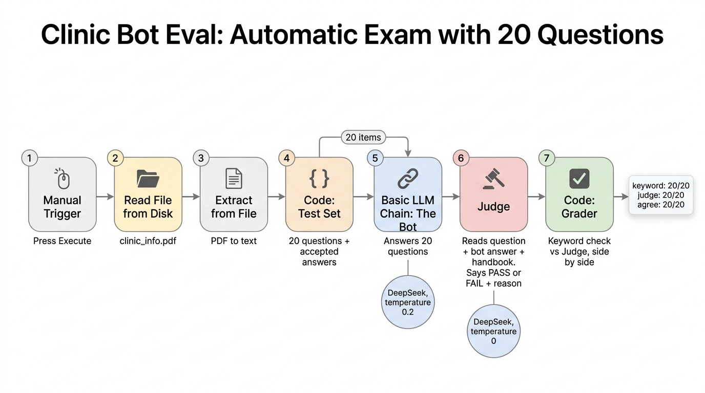

# Smile Clinic Telegram Bot (n8n)

A Telegram assistant for a dental clinic, built with **n8n** (no-code workflows), **DeepSeek** via OpenRouter, and a small **FastAPI** embedding server in Python.

Part of my series: **My GenAI Journey | Project #2**.

## What it does
- Answers patient questions **only from the clinic handbook** (`clinic_info.pdf`), in the patient's language (English or Arabic).
- **Remembers the conversation** (last 10 Q&A per patient, keyed by Telegram chat ID).
- **Hands off to a human**: when the answer is not in the handbook, the patient asks for a person, or it is an emergency, the receptionist gets an alert with the patient's name, chat ID and question.


## Workflows (in this repo)
| File | What it does |
|---|---|
| `Smile Clinic Bot.json` | The live bot: Telegram Trigger, read handbook PDF, AI Agent + memory, reply, human handoff |
| `Clinic Bot Eval.json` | Automatic exam: 20 questions, keyword check + LLM judge |
| `Paper RAG - Index.json` | Splits my research paper into chunks, embeds them, stores them |
| `Paper RAG - Ask.json` | Chat: retrieves the top 3 chunks and answers from them |
| `Paper RAG - Eval.json` | Retrieval exam: 40 questions, Hit@1 and Hit@3 |
| `embed_server.py` | Local FastAPI server for `BAAI/bge-small-en-v1.5` embeddings (OpenAI-compatible) |

## How to run (Windows)
Terminal 1 (public tunnel for Telegram):
```
ngrok http 5678 --url https://<your-ngrok-domain>
```
Terminal 2 (n8n):
```
$env:WEBHOOK_URL="https://<your-ngrok-domain>/"
$env:N8N_RESTRICT_FILE_ACCESS_TO="<path to this folder>"
n8n start
```
Terminal 3 (embedding server, only for the paper RAG):
```
conda activate genai
uvicorn embed_server:app --port 8000
```
Then import the JSON files in n8n and add your own credentials (Telegram, OpenRouter). In `Smile Clinic Bot.json`, replace `YOUR_RECEPTIONIST_CHAT_ID`.

## Results

### Clinic bot (handbook in the prompt)


| Check | Score |
|---|---|
| Keyword match | 20/20 |
| LLM judge | 20/20 |
| Agreement | 20/20 |

Limitation: the judge uses the same model as the bot (DeepSeek v4.1 flash), because the API key only allows this model. A judge from a different model family would be stronger.

### Paper RAG: n8n vs my Python project
Same embedder (`bge-small-en-v1.5`), same chunking (500 chars, 150 overlap), same 40 questions.

| System | Hit@1 | Hit@3 |
|---|---|---|
| n8n, semantic only | 48% | 65% |
| Python, semantic only | 42% | 70% |
| Python, final (Hybrid + Re-ranker) | 70% | 90% |

**Takeaway:** with the same method, n8n and Python are about the same (each question = 2.5%). The big jump comes from hybrid search and re-ranking, which I built in code ([chat-with-pdf](https://github.com/fatmanagahheikal/chat-with-pdf)).

## Lessons learned
1. **Clear Store + batches bug:** with `Embedding Batch Size = 200` and `Clear Store` on, only the last batch (26 chunks: references and author bios) stayed in the store. Every question returned the end of the paper. Fix: batch size 500 (one batch).
2. **References pollute retrieval:** reference titles are full of the same words as the questions ("pig skin"), but contain no answers. My Python version separates the references section; default n8n does not.
3. **No page numbers:** the default n8n PDF loader keeps line numbers, not pages, so answers cite chunks instead of pages.
4. **Hardware matters:** indexing took 30 min with RAM at 79%, and 7 min after closing tabs (Python: 8 min) on an AMD E2-9000 laptop (2 cores, 15 GB RAM).
5. **RAG is cheaper:** about 700 tokens per paper question vs about 2,400 for the clinic bot that sends the whole handbook.

## Next steps
- Connect n8n to the Python RAG through FastAPI.
- Persistent memory and vector store (Postgres / Redis) with Docker.
- Re-ranking inside n8n.